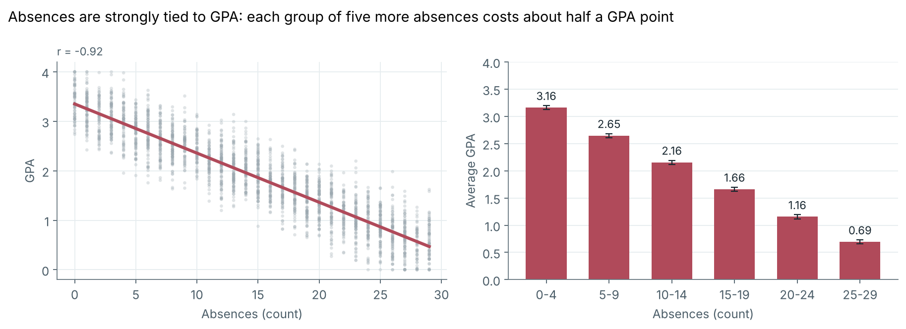
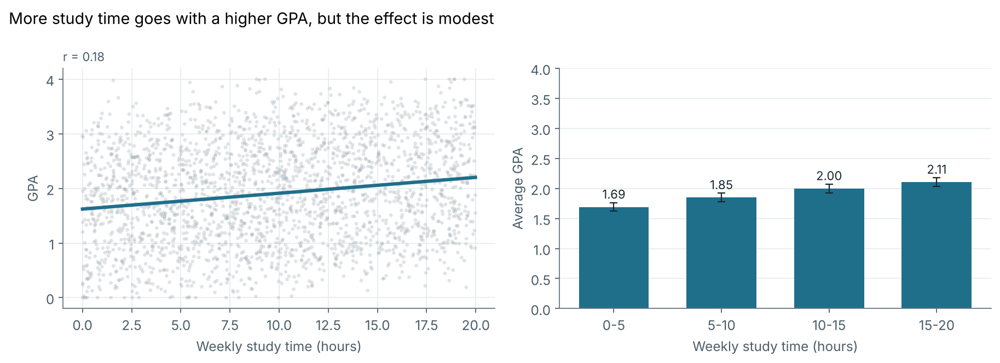
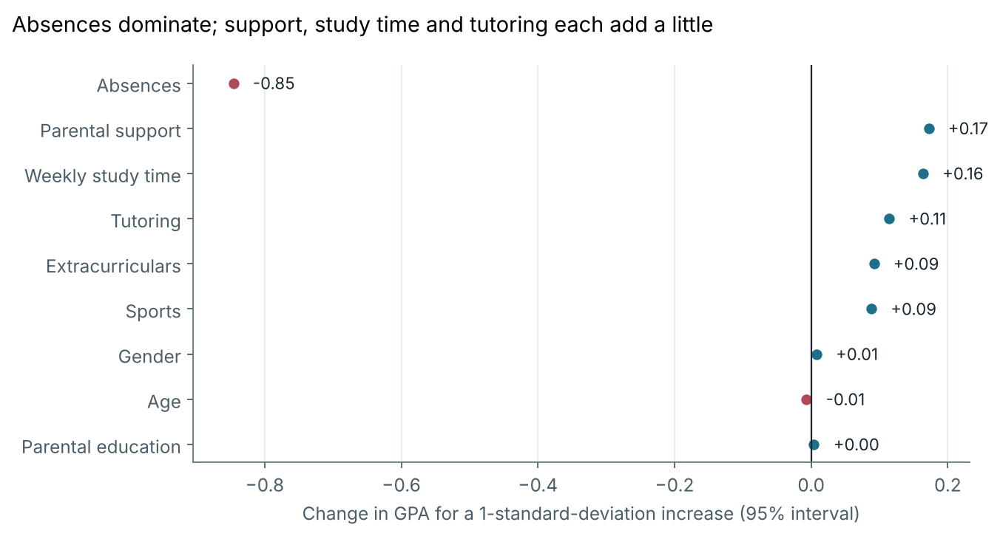
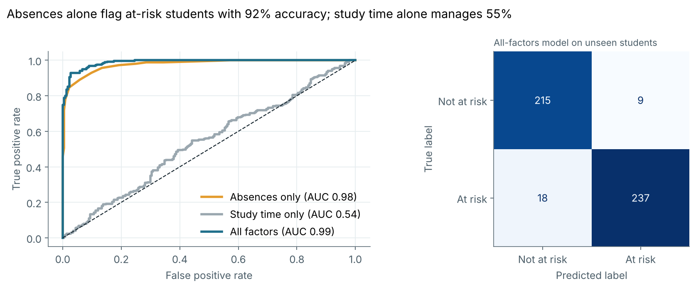

# Student Performance Analysis: What Drives GPA?

Do students who study more earn higher GPAs? Do students who attend more? And when every factor is considered together, what matters most, and how well can GPA be predicted and at-risk students flagged?

This project answers those questions with hypothesis tests, multiple regression, predictive models and an early-warning classifier on 2,392 student records.

**Tools:** Python, pandas, SciPy, scikit-learn, matplotlib · **Notebook:** [`student_performance_analysis.ipynb`](student_performance_analysis.ipynb)

## Key results

- **Absences are the dominant factor.** Each additional absence goes with about **0.10 lower GPA** (r = -0.92). Students with 0-4 absences average a 3.16 GPA, while students with 25-29 absences average 0.69.
- **Study time helps, but modestly.** About **+0.03 GPA per weekly study hour** (roughly +0.3 GPA for 10 more hours). On its own it explains about 3% of GPA variation.
- **Other factors each add a little:** tutoring (+0.25), parental support (+0.15 per level), extracurriculars (+0.19) and sports (+0.19). Age, gender and parental education show no clear effect.
- **GPA is highly predictable in this data.** A linear regression predicts GPA for unseen students with an error of about 0.20 GPA points (R-squared 0.95), against 0.91 for guessing the average. Random forest and gradient boosting did not beat it.
- **Early-warning flag (GPA below 2.0):** absences alone identify at-risk students with 92% accuracy; study time alone manages 55%, barely above the 53% majority-class baseline. Using all factors reaches 94% accuracy (precision 96%, recall 93%).





<p>


</p>

## What the analysis covers

1. **Data audit:** types, missing values, duplicates, ranges, and a consistency check between `GPA` and `GradeClass`.
2. **Description:** mean, median, spread and distributions of the key variables.
3. **Hypothesis 1 (study time) and Hypothesis 2 (attendance):** Pearson and Spearman correlations with confidence intervals, regression slopes, group comparisons with Welch t-tests and effect sizes.
4. **Multiple regression** on all nine predictors with heteroskedasticity-robust standard errors, standardized effects, multicollinearity (VIF) and residual diagnostics.
5. **Prediction:** a held-out test set and 5-fold cross-validation comparing linear regression, random forest and gradient boosting against a baseline, plus permutation importance.
6. **At-risk classification:** logistic regression on absences only, study time only and all factors, evaluated with accuracy, precision, recall, F1, ROC AUC and a confusion matrix.

## Data

`data/student_performance.csv`: 2,392 students (15-18 years old) with weekly study time, absences, tutoring, parental education and support, extracurricular and sports participation, GPA (0-4) and a letter-grade class.

**Source:** [Students Performance Dataset (Academic Success Factors in High School Students), by Rabie El Kharoua, Kaggle](https://www.kaggle.com/datasets/rabieelkharoua/students-performance-dataset). The Kaggle listing is tagged as synthetic data. This copy keeps 12 of the original columns (the ethnicity, music and volunteering columns were left out).

## Run it yourself

```bash
git clone https://github.com/<your-username>/student-performance-analysis.git
cd student-performance-analysis
pip install -r requirements.txt
jupyter notebook student_performance_analysis.ipynb
```

Run the notebook from the repository root so the relative `data/` and `figures/` paths resolve. All random steps use a fixed seed, so results are reproducible.

## Limitations

- **The data is synthetic.** The source listing is tagged synthetic, and the numbers agree: the predictors are almost perfectly uncorrelated with each other, study time and absences are close to uniform, and a model explains 95% of GPA variation, far more than is typical for real student records. Results describe this dataset, not real students.
- **Association, not causation.** Absences could be a symptom (illness, disengagement) rather than a cause of low grades.
- **`GradeClass` agrees with `GPA` for only 93% of students**, so it was left out of every model to avoid leakage.
- **Ordinal scores (0-4) are treated as numeric,** which assumes equal steps between levels.

## Next steps

- Repeat the analysis on real school data.
- Test interactions (for example, tutoring effects at different absence levels) and recode ordinal scores as categories.
- Add term-by-term data so the early-warning flag only uses information available before grades are final.
